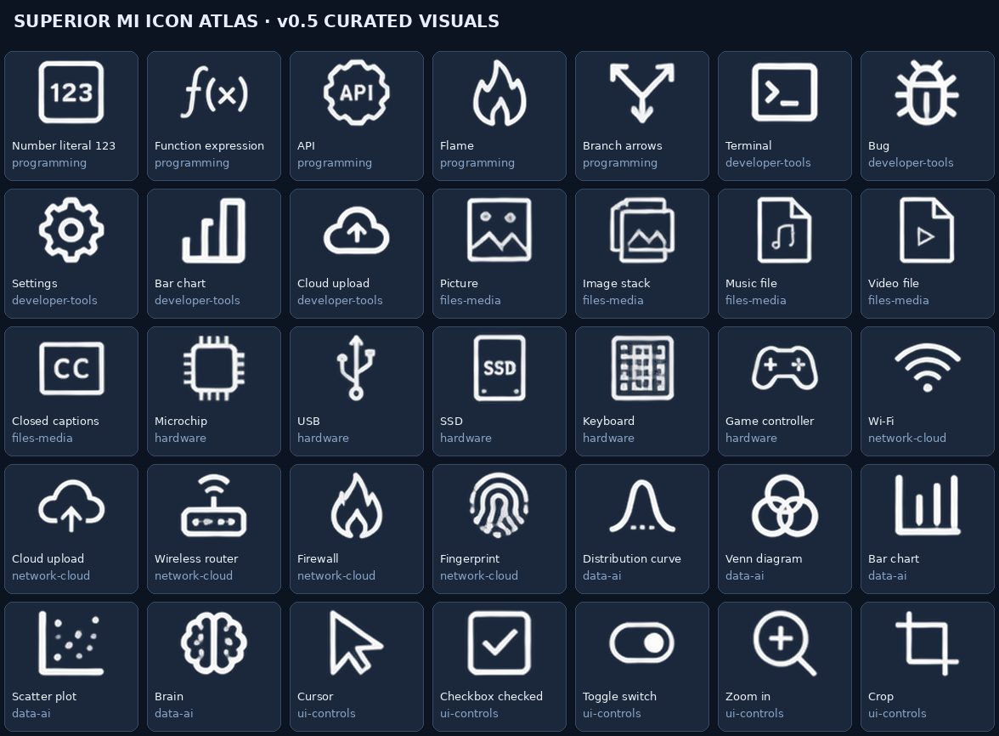

# Superior MI Visual Atlas (formerly Icon Atlas)

**Reusable transparent icon atlases, a typed manifest vocabulary, and a searchable static browser.**

[Browse the icon gallery](https://superior-mi-labs.github.io/Superior-MI-Icon-Atlas/) · [Manifest index](manifest.json) · [Architecture](docs/ARCHITECTURE.md) · [Artwork policy](docs/ARTWORK-POLICY.md)

## v0.12.0 — GUI visibility fix + AI production pipelines

- **Fixed interactive energy meter:** numeric range values are normalized for clip/position; a meter draws frame → fill → movable thumb, so changing 0/50/100 produces actual visual differences instead of a permanently empty or full bar.
- **Mandatory type-specific AI pipeline gates:** icons, directional character animations, GUI/interactions, materials/overlays, multi-pack collections. Every category links back to the same authoritative release checklist.
- **Executable interactive checks:** validate native input range, layer ordering, event and output mapping, clip/position input bindings. Added regression tests and an interactive HUD acceptance fixture.
- **Transparency and visual correctness:** auto-checks catch structure, but manual frame-by-frame inspection and a real browser render test remain distinct from JSON validation.
- Existing 2,073 icons are unchanged.

## v0.11.0 — AI recipe hierarchy and Explore template discovery

- **Small AI entrypoint:** `docs/ai/START-HERE.md` has a short mandatory to-do list and routes to a categorized recipe library. Agents read only task-relevant instructions plus the common QA gate, avoiding context overload.
- **Five recipe groups:** icons, animations/characters, GUI interactions, multi-manifest collections, and layered materials. Shared [manifest/API reference](docs/ai/FORMAT-API.md), [final release checklist](docs/ai/RELEASE-CHECKLIST.md) and real executable sample ZIPs.
- **Four new exact-coordinate starter packs:** simple icon, animated icon, character states and GUI meter. Their source manifests and original artwork live under `examples/`; the site builder deterministically packages them as ZIPs.
- **Explore full asset packs:** public template cards and search derive their information from the actual bundled ZIP manifests; `Open in Builder` imports and previews the corresponding example. The existing 2,073 icon catalog remains intact.
- **Executable user-specific QA:** `tools/ai_acceptance.py PACK.zip --acceptance TEST.json --out qa/...` evaluates the request-specific assertions, actual animation frames and named states/presets before printing an honest PASS/FAIL.
- **Validation gates:** actual example ZIP schemas and pixel regions, documentation links, generated featured index, and URL routing have regression tests. Every AI release still requires a creator-specific acceptance test and a truthful QA receipt.

## v0.10.0 — AI production kit, exact-grid starters and visual QA

- **Short AI handoff:** [AI guide](web/ai-guide.html) links to [START-HERE](docs/ai/START-HERE.md), [pixel/animation QA](docs/ai/QA-CHECKLIST.md), [working templates](docs/ai/TEMPLATES.md) and [compact prompt examples](docs/ai/PROMPT-EXAMPLES.md). Instructions are progressive, not pasted into one enormous prompt.
- **Creator intent:** the AI reconstructs a faithful structured brief from the conversation, honors constraints, chooses a working template, creates textures, and reports actual tests.
- **Authoring layouts:** downloadable blank textures and guide overlays for 24×8 icons, 8×4 sprites, and freeform UI. These are **packing destinations, not inferred grids in generated artwork**.
- **Per-region pixel QA:** `tools/qualify_asset_zip.py` scans all regions in a pack/collection, reports real alpha bounds and pixel hashes, flags empty and border-touch crops, and produces labeled contact sheets. It uses the existing structural ZIP and manifest validator and does not claim to understand semantics.
- **Honest release receipt:** automated PASS means structurally ready for **visual review**, not a guarantee that artwork is correct, rights-cleared or animations look good. Every crop must still be inspected by the creator/AI with genuine visual access.
- **No changes** to existing 2,073 icon pixels or IDs; v0.9 slots/presets and older pack formats remain supported.

```bash
bash RUN-ALL.sh
python3 tools/qualify_asset_zip.py web/demo/potions-collection.zip --out /tmp/potion-qa
# contact sheets + qa-report.json + qa-receipt.txt
```

## v0.9.0 — Compatible slots, automatic presets, and a multi-pack template

- **One working template system:** composition layers can reference named compatible slots. Versioned interfaces define expected logical dimensions; permitted replacements explicitly implement those contracts. This works across manifests within one ZIP collection.
- **AI-first defaults:** opening the Potion Lab example automatically previews the bottle. Select `Health`, `Mana` (animated blue), or `Poison` from a generated preset selector. Manual layer edits are not needed.
- **Portable export:** a selected composition ZIP includes the **entire declared slot-option dependency closure**, including animation frames, interface definitions, textures and license notices. Private bags keep interface metadata isolated so different bags cannot override each other's contracts.
- **Compatibility:** existing `smi-visual-pack/1` ZIPs, `smi-visual-collection/1` collections, and all **2,073 public icon IDs** continue to work without migration.
- **Validation:** Python and JavaScript reject incompatible replacements, missing/invalid slot options, wrong interface versions, invalid preset values, and missing references. Includes new [AI creation docs](docs/SLOTS-PRESETS.md) and a real self-contained [Potion Lab template ZIP](web/demo/potions-collection.zip).
- **Limits:** compatibility tests validate declared geometry and references, not the artistic fit of independently created drawings. No automatically inferred cross-pack compatibility or host-side pointer handling is claimed.

## v0.8.0 — Multi-manifest collection bags + typed interaction contract

- **One ZIP = one private collection**, with an optional `collection.json` index, up to 96 `smi-visual-pack/1` manifests, and cross-manifest asset references. No special 12-manifest cap.
- **My Bag**: drag-and-drop ZIP import; one card per collection; open, filter by manifest group, download original ZIP or remove. Optional explicit IndexedDB local storage; otherwise session-only. No user asset upload endpoint.
- **Generic interaction contracts**: assets may declare semantic roles (button/toggle/slider/actor), typed inputs, events, restricted set/toggle/emit actions, and read-only outputs. The host application handles actual pointer/game input and consumes events.
- **Local-first validation**: JSON Schema for both manifest and collection index; cross-pack dependency graph, geometry, event binding and ZIP entry safety checks. The existing 2,073 source icons remain unchanged.
- **Export round-trip**: the builder removes transient My Bag bookkeeping from the authored output; export passes the standalone pack validator.
- **Known scope limit**: the builder shows action buttons and typed controls, but does not yet implement native on-canvas pointer capture/drag interfaces, automatic template slot swapping, user-authored persistence sync, or a full animation state-machine engine.

### Collection ZIP layout

```text
collection.json                      # optional smi-visual-collection/1 index
packs/character/manifest.json        # smi-visual-pack/1, asset definitions
packs/character/textures/body.png
packs/hud/manifest.json
packs/hud/textures/gui.png
```

The root index names each manifest and may set the default `entry_asset`. Asset IDs are globally unique within a ZIP; the same asset can be referenced from a different manifest in the same collection. A one-manifest ZIP from v0.7 remains valid.

## v0.7.0 — Keyframe timeline, frame exports and reliable publisher

- **Fixed Linux publisher:** the previous v0.6.0 script attempted the Python test suite before installing `jsonschema`; `RUN-ALL.sh` now installs missing Pillow/jsonschema into an isolated reusable venv and executes the full required tests before any Git operation.
- **Timeline editor:** select a composition layer, scrub time, set/delete keyframes for x, y, opacity, scale X/Y and rotation; choose linear, smooth or step interpolation.
- **Playback:** per-composition `duration_ms`, loop / once / ping-pong. A pure `timeline-core.js` drives browser rendering and Node regressions.
- **Portable animation:** layer tracks are authored into exported `smi-visual-pack/1` manifests and survive reimport. An additional export option writes timed PNG frames and `frames.json` into a ZIP.
- **Private safety:** ZIP imports enforce member and total uncompressed-size limits before CRC inflation; the pack validator rejects invalid frame ordering or impossible values.
- **Compatibility:** the original 2,073 icon IDs and pixels are unchanged. The builder and v0.6.0 pack formats remain compatible; `tracks` and `duration_ms` are optional fields.

### Run and publish

```bash
bash RUN-ALL.sh          # full QA; installs missing deps in a private venv
bash RUN-LOCALLY.sh     # starts local static site (Ctrl+C to stop)
# After the tests pass, use bash publish-to-github.sh to publish this release.
```

The runtime is a local-first Canvas 2D preview, not a server-side upload tool. Browser preview tests performed against injected Chromium resources and a real ZIP import→export→reimport cycle. Browser-navigation restrictions prevent directly testing the GitHub Pages URL here.

## v0.6.0 — Local-first Visual Atlas Builder

This release adds a separate local-first builder for browsing and composing imported icons, sprites, layers, states, animation sequences and GUI components. **Existing v0.5.0 icon artwork and IDs remain unchanged.**

## v0.5.0 — Visual curation and search precision

- **2,073 original candidate icon positions** in **20 real 24×8 sheets**, each 2304×768 with 96×96 cells.
- **White monoline artwork on transparent RGBA**; recolor using the alpha of the atlas itself while keeping black outlines separate.
- **Per-sheet authored manifests**, with one small `manifest.json` index; browser search data is generated, not manually edited.
- **734 visually reviewed symbols**, including `Flame`, `Picture`, `Lambda`, `Terminal`, `Folder`, and common file actions. The other **1,339** remain unreviewed candidates, not falsely described.
- **One stable icon ID per crop**. Concept IDs, display names, aliases and search tags may be curated without moving geometry or changing candidate IDs.
- Search expands curated synonyms (`fire` / `flame`, `picture` / `image` / `photo`), ranks meaningful names before generic categories, and supports automatically populated style, subject, domain, and review filters.



### Quick start

```bash
python3 -m pip install -r requirements-test.txt
python3 atlasctl.py validate --deep
python3 atlasctl.py search flame
python3 atlasctl.py search picture --status reviewed
python3 atlasctl.py info icons.candidate.programming.r04i19
python3 atlasctl.py crop icons.candidate.programming.r04i19 --out flame.png
python3 atlasctl.py tint icons.candidate.programming.r04i19 --color '#4B9CFF' --out flame-blue.png
python3 tools/build_site.py
python3 -m http.server 8000 --directory site
```

Navigate to `http://127.0.0.1:8000/` for local browsing. GitHub Pages builds from the same files on pushes to `main`.

### Where the files live

- `manifest.json` — compact authoritative index and shared style/search vocabulary.
- `manifests/<sheet>.json` — **only authored icon metadata** for that sheet: ID, source, cell, crop checksum, review status, names, aliases, tags and subjects.
- `sheets/<sheet>/atlas.png` — production white transparent atlas; foreground alpha also acts as its tint mask.
- `sheets/<sheet>/black-outline.png` — optional overlay for tinted rendering.
- `sheets/<sheet>/inspection-preview.png` — review-only image; **never render as a production texture**.
- `source-images/` — retained original research images for provenance, **not live atlas assets**.
- `atlasctl.py` — manifest loader, validation, search, crop and tint tooling.
- `tools/review_icon.py` — modifies the one owning sheet manifest (no parallel search registry).
- `tools/audit_repo.py` — on-demand duplicate/reference and backlog report.
- `tools/build_site.py` — generates browser data; `site/` is a build output and is not committed.
- `docs/ARCHITECTURE.md` — downstream usage contract and alternatives considered.

### Name an icon after visual inspection

```bash
python3 tools/review_icon.py icons.candidate.programming.r04i19 \
  --name Flame --tags 'fire,flame,blaze,burn,heat' \
  --subjects nature.fire --concept nature.flame
python3 tools/build_site.py
```

Only confirmed visible properties should be used as search tags. A generic source row, filename, or neighboring image does **not** prove visual meaning.

### Compatibility and licensing

This is **schema v3**, a breaking catalog-layout change from the old 3.3 MB v2 manifest. Existing icon IDs, source atlases, crop rectangles and crop hashes are preserved. Consumers should iterate `manifest.json → sheets[].manifest → icons[]`; see [architecture and migration contract](docs/ARCHITECTURE.md).

The Apache-2.0 root license applies to project code and metadata. Art assets were generated for this project; their **visual quality and provenance remain under review**, so do not treat an unreviewed icon as a guaranteed original, publication-cleared illustration. The historical third-party research pack is not included.

## Visual-review progress (v0.5)

734 of 2,073 icons now have inspected visual names, narrowly scoped subjects and useful search tags. This patch adds 685 visual reviews across programming-adjacent tools, networking, hardware, data/AI, files/media and UI controls. The remaining 1,339 are explicitly unreviewed and have no invented semantic tags. Visual labeling does not confer legal or artwork-clearance status.

Search scores direct token matches above related-word matches to prevent a broad synonym like `heat` from returning unrelated hardware when looking for `fire`. Exact asset IDs and crops are unchanged.
